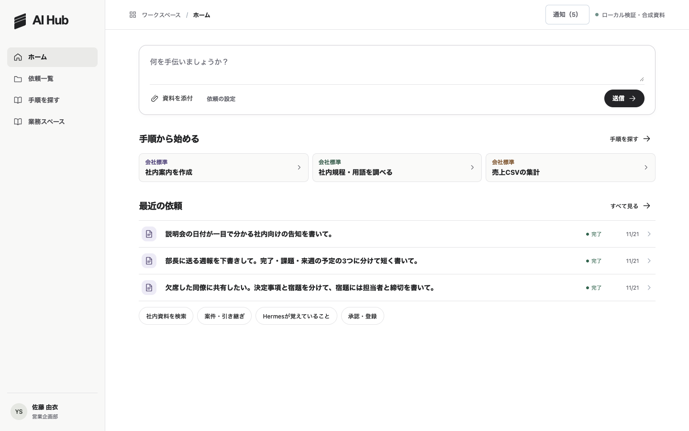
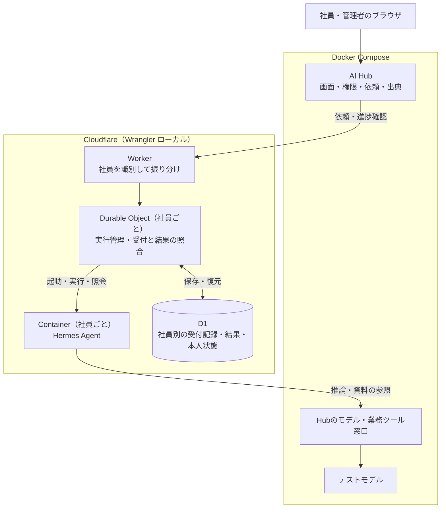

# AI Hub

AI Hub は、社員が自分専用の Hermes Agent に社内資料を渡し、出典を確かめながら仕事を進めるためのワークスペースです。たとえば「出張を取り消したとき、精算に何が必要？」と聞くと、回答から旅費規程の該当箇所を開けます。続けて回答を書き直したり、確認が必要な点を窓口に問い合わせたりできます。元の資料、会話、採用した版は同じ依頼にまとまります。



## 起動と操作

用意するものは Node.js 24 以上と、Docker Compose v2.33.1 以降が動く Docker 環境です。初期構成にはサンプル資料と固定応答のテストモデルが含まれており、外部モデルの API キーを用意せずに操作を試せます。

```sh
git clone https://github.com/TommyKammy/AI-Hub.git
cd AI-Hub
node infra/init.mjs
docker compose --env-file .runtime/local.env up -d --wait
```

### 最初の依頼で、回答の根拠を開く

1. [佐藤の社員ホーム](http://127.0.0.1:18731/)を開き、依頼欄に `@旅費` と入力します。候補から「旅費規程.md」を選びます。
2. 選んだ資料を「原文を開く」で確認し、「出張取消料の精算には何を添付しますか？」と質問して送信します。
3. 回答の出典番号を押し、第8条の「取消料の領収書」と「所属長の承認記録」を確認します。「依頼一覧」から後で同じ回答と資料を開けます。

[田中の社員ホーム](http://127.0.0.1:18732/)では別の社員の視点を試せます。このデモではポートごとに社員が固定され、同じPCから両方の画面を開けます。

### 次に試せること

| やりたい仕事 | 試し方 |
| --- | --- |
| 2社の見積を比べる | 見積書を2件添付して「金額と納期を比較して」と依頼します。比較表の出典から各社の原文を確かめられます。 |
| 問い合わせを引き継ぐ | 回答から起票案を作り、宛先と本文を確認して送信します。受付票に届いた追加質問や回答を、元の仕事の改訂に使えます。 |
| 毎週の報告を下書きする | 採用した週報から「この版から定期下書きを予約」を選びます。資料・周期・次回日時を確認すると、予定時刻に自分の依頼一覧へ下書きが届きます。 |

終了するときは次のコマンドを使います。依頼履歴は名前付きボリュームに残ります。再開するときは起動時と同じ `up -d --wait` を実行してください。

```sh
docker compose --env-file .runtime/local.env stop
```

## Cloudflare で動かす場合の構成

Cloudflare との結合試験では、社員ごとの Hermes 実行環境を Cloudflare Containers に配置します。以下はこのリポジトリで再現できる**ローカル検証構成**です。Wrangler が Cloudflare 側を起動し、画面・権限・元資料を管理する AI Hub とテストモデルは Compose 側で動きます。



たとえば通信が途切れて受付応答を受け取れなかった場合、社員別の Durable Object が元の実行を照会します。D1 に保存した完了結果はコンテナの停止中にも取得でき、Hub は社員の権限と出典を確認して元の依頼に戻します。[復旧試験の手順と構成](test/integration/cloudflare-recovery/README.md) · [資料到着を待って実行する試験](test/integration/cloudflare-arrival/README.md)

## さらに詳しく

- 社員画面での資料指定、見積比較、問い合わせ、定期予約の操作例は[社員ガイド](docs/employee-guide.md)にあります。
- モデルの接続・公開や社員の権限を試すには、[管理者画面](http://127.0.0.1:18733/admin.html)と[管理者ガイド](docs/admin-guide.md)を使います。
- 開発環境とテストの実行方法は[開発ガイド](docs/development.md)にあります。Node.js のテストはリポジトリ直下で `npm ci`、`npm test` の順に実行できます。
