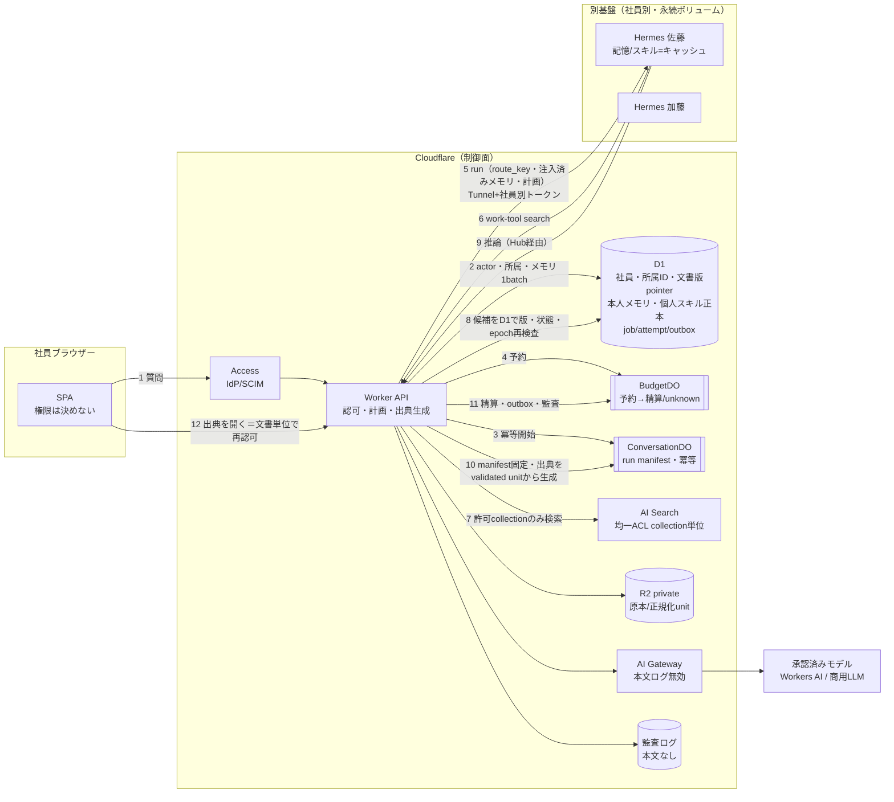

# AI Hub（Hermesベース）独立レビュー報告

レビュー日：2026-11-22／レビュー者：Claude Opus 5.5
対象：`archive/Planning_Pack_v0.1.2/`（設計パック）、`hermes-ai-hub/`（Hermes採用版）、`hermes-ai-hub/ai-hub-home-mockup.html`（操作可能モック）

## 0. 採否判断

**判定：設計変更が必要**

**推奨構成**
- Cloudflareは入口と制御面を担います。Access、Worker API、D1、Durable Objects（予算・会話）、AI Gateway、AI Searchを置きます。
- 社員ごとのHermesは、**永続ボリュームを持つ別基盤のユーザー別コンテナ**で動かします。Cloudflare TunnelとサービストークンでWorkerから呼びます。
- Hermesが持つ記憶・個人スキル・受付記録は、どれもHub（D1/R2）を正本とする**派生キャッシュ**に降格します。

**最大の未解決点**
- **本人状態（メモリ・スキル・実行の受付記録）の正本が二重になっています。** 設計パックはD1を正本としています。一方Hermes採用版は、Hermesのローカルディスク（`/opt/data`）に正本を置いています。
- このままCloudflare Containersへ載せると、休止のたびにディスクが初期化されます。その結果、記憶・スキル・照合の証拠を失います。
- 永続基盤へ載せても、削除・バックアップ復元・異動時の責任が定まりません。

### 検証範囲

| 区分 | 内容 |
|---|---|
| 実際に操作した（静的モック、Chromium系ブラウザーペイン） | 4シナリオのうち以下を操作した。 ・佐藤の出張取消質問と出典表示 ・佐藤／加藤のPO質問と、加藤の異動後の再表示 ・青木の配布設定画面と社員別プレビュー ・森の管理画面 ・窓口登録案の作成、差し戻し（キーボードのみ）、修正・再提出、承認（ダブルクリック）、元の仕事からの再表示 ・375px幅の表示確認 |
| コードだけ確認 | Hub側の処理：`hub.mjs`の送信・再起動・照合、`gateway.mjs`のwork-tool認可、`libraries.mjs`の検索、`personal-work.mjs`の共有 Hermes側の設定・ツール：`infra/receipt-reader.py`、`infra/hermes.yaml`、`infra/work_tools.py` モックの未操作分：配布設定の保存処理 |
| 未実行 | Hermes採用版のCompose起動と`node --test`、実Hermesの推論、実検索の品質、Cloudflare上の挙動はすべて未検証。 本報告の基盤に関する指摘は、コードと公式資料の読解に基づく。 |
| 参照できなかった資料 | `DESIGN_REFERENCE.md`が参照する6画面PNGと`docs/24_SCREEN_SPECIFICATIONS.md`は今回読んでいない。 Hermes Runs APIの公式仕様（Idempotency-Keyの意味論）は未取得。 |

---

## 1. 資料間の差の分類

| 論点 | 設計パック | Hermes採用版 | 分類と根拠 |
|---|---|---|---|
| 本人メモリの正本 | D1。明示保存、承認後に利用、`memory_epoch`、削除は原子的（`docs/07_MEMORY.md:9,13,27`） | Hermesの`memory`/`user_profile`をON（`infra/hermes.yaml:19-21`）。希望はHermesが直接プロフィールへ保存し、Hubに記録が残らない（`hub.mjs`の`profileInstructions`） | **実装上の矛盾**。採用版READMEに設計パックからの変更理由がなく、意図的変更の記録はない |
| 個人スキル | 個人agentの版をD1で管理 | `SKILL.md`はHermesホームにある。比較項目・ルール・ハッシュはHubの`quote_skills`が保持（`work_tools.py:35-53`、`gateway.mjs`の`confirm_quote_skill`） | **部分的に整合**。Hubが内容とハッシュを持つので、Hubを正本にできる良い型。ただしHermes側の再生成手順がない |
| 会話・実行の正本 | ConversationDO SQLite（`02_ARCHITECTURE.md:12`） | Hub SQLiteとHermesの`state.db`／`runs_idempotency.db`。照合はHermes内部DBを直接読む（`receipt-reader.py:14-46`） | **未決定事項**。採用版はHermesの保存形式に固定して依存している |
| 予算 | 最初の有料処理より前にBudgetDOで予約し、事後に精算（`02_ARCHITECTURE.md:13,26`） | `model_calls`への事後記録だけ。再起動時に`sending`を`unknown`へ変える（`server.mjs:24`） | **未実装**（v0.1のG2対象） |
| 検索 | ACLが均一なcollectionごとにAI Search instance、D1で版を事後再検査（`08_RAG.md:21,31,41`） | ファイルシステムのフォルダー名と所属名の文字列一致。全文を読む語彙スコア。版は「検索時の本文ハッシュ」（`libraries.mjs:16-33,57-77`） | **意図的な暫定**（ローカル合成資料用）。ただし旧版の除外と公開pointerは設計パックの要件を満たさない |
| 窓口登録の承認 | 未記載（v0.2+で外部tools） | 依頼者が直接起票。承認段階はない（`inquiries.mjs`） | **モックと実装の差**。モックは「上長承認」を約束しているが、実装にない |
| 異動時の旧成果物 | 本文read・ダウンロードのたびに再認可 | 資料置き場を使った仕事は、所属が変わると**仕事全体**を非表示にする（`hub.mjs:155`） | **モックと実装の差**。モックは**引用単位**で黙って消す |

---

## 2. 設計判断

### 2.1 Hermesの配置と永続化

| 判断軸 | A：Cloudflare Containersで社員別に起動（DO ID＝社員） | B：別基盤の社員別コンテナをCloudflareから呼ぶ |
|---|---|---|
| コールドスタート | 停止状態からの起動は「多くは1〜3秒」。これにHermes自身の起動とMCPツールの起動が加わる（未測定）。インスタンスの配置場所はDOと一致しない | 常駐させれば0。休止させる運用ならA以上（k8sのscale-to-zeroなど） |
| 休止・更新時の復元 | **ディスクは既定で揮発**し、休止後は新しいディスクから起動する。 永続化の手段はsnapshot（`durable_object`ポリシー限定、イミュータブル、保持30日、beta）か、R2のFUSEマウント（SSD性能なし）。 更新時はSIGTERMの後、最大15分で停止する | 永続ボリュームでそのまま維持できる。イメージ更新もローリングで状態を保持する |
| SQLite・メモリ・スキル | Hermesの`state.db`や記憶ファイルをFUSE上のSQLiteに置くのは、ロックと性能の面で非推奨。 **Hermesをステートレス化して、起動時にHubから再水和する**ことが前提になる | 現行構成（名前付きボリューム）をそのまま移せる。ただし正本問題は残る（指摘2） |
| 同一社員の同時依頼 | DOが単一スレッドで直列化しやすい。ただしHermesの処理時間はDOの処理枠と別に管理が必要 | Hubの`blockingJob`による社員単位の直列化をそのまま使える（粒度の問題は指摘4） |
| 資格情報の分離 | microVMで分離される。秘密値はWorker Secrets経由で、社員ごとのキーはDOが発行できる | ネットワークを社員ごとに分け、キーは社員ごとに発行する（現行の`compose.yaml:1-97`と同型）。基盤のIAMが別途必要 |
| 運用 | 基盤の運用が不要。課金は稼働中の10ms単位 | クラスター運用、パッチ、バックアップを自前で持つ |

**推奨：B（別基盤の永続コンテナ）。** Hermesを維持する前提では、受付照合（`receipt-reader.py`）、記憶、個人スキルのすべてがHermesのローカルSQLiteに依存しています。Aは揮発ディスクなので、この依存を外さない限り成立しません。

**選択が逆転する条件**（すべて満たせばAが有利）
1. Hermesを「実行ごとに使い捨て」にできる。つまり記憶・スキル・手順を実行開始時にHubから注入し、Hermesの内部DBを照合に使わない（指摘3の修正後）。
2. 実測したコールドスタートのp95（起動〜初回トークン）が、社員の許容値以内に収まる。案として8秒。
3. 同時稼働数×インスタンス型の費用が、別基盤の常駐費用を下回る（§2.4）。
4. データ所在の要件（国内限定など）が、Containersの配置制御で満たせる。Containersの配置場所は保証されないため、要確認。

### 2.2 認可とRAG：規程質問の経路と再確認点

**認証された社員から検索対象を決める流れ（採用版の現状）**
1. `activeMember`で、在籍中かつ有効な社員を確認する。
2. `listLibraries`が`shared/`、`teams/<所属>/`、`users/<ID>/`の順にフォルダーを列挙する。
3. 仕事の受付時に、`library_selection`と`scope_team`を保存する。
4. Hermesのwork-tool呼出しのたびに、gatewayが次をすべて満たすかを**毎回**SQLで確認し、該当する仕事に限って検索する（`gateway.mjs:92-108`）。
   - ticket
   - 社員
   - `member_revision`
   - モデルが停止中でないこと
   - `permitted_job_teams`
5. 検索結果の本文は`sources_json`に複製され、以後はそこから表示する。

**評価**

| 観点 | 評価 |
|---|---|
| 送信中の異動 | `member_revision`の一致を確認しているので、送信中の異動は検出できる。良い点 |
| 旧版規程 | 同じフォルダーに旧版ファイルが残っていると、両方が検索対象になる。「公開中の版」の概念がない |
| 索引更新の遅れ | 現行は毎回の全文読込みなので遅れはない。代わりに1依頼16MiB／500文書が上限で、規模が増えると成立しない。 AI Searchへ移すと遅れが生じる。外部ソースの同期は既定24時間（最短15分）、手動同期は30秒に1回まで。内蔵ストレージはアップロード時に即時索引。 このため、**D1で版を事後照合すること（`08_RAG.md:31`）が必須** |
| キャッシュ | 検索結果を`library_hits`として仕事単位で固定している（同じ実行内の一貫性は良い）。 ただし表示時に、元文書が「いま有効か」は再確認していない |
| 過去の成果物 | 所属が変わると、資料置き場を使った仕事全体が見えなくなる。一方、添付だけの仕事は所属と無関係に読める（`hub.mjs:155`）。会議メモに部門資料を貼った場合の境界は利用者任せ |
| 出典リンク | 仕事を読めるかどうかに従う。文書単位の再認可はない |
| 共有先 | **再認可がない**（指摘1） |
| 個人メモリの削除 | Hub側に操作がなく、Hermesのプロフィールに残る（指摘2） |
| スキルのチーム公開 | 公開手順はHubで審査した本文とハッシュで管理しており、混入しにくい。 見積の個人スキルは、金額・会社名を正規表現で拒否している（`gateway.mjs`の`prepare_quote_skill`）。ただし「チーム公開」の経路は手順の草案だけで、個人スキルを公開する経路はない |

**再確認すべき時点（推奨）**
1. 受付時：AuthorizedSearchPlanを作る。
2. 検索直後：D1で文書・版・unit・状態を照合し、epochを確認する。
3. 生成直前：epochを確認する。
4. 表示・ダウンロード・共有の閲覧時：文書単位で再認可する。
5. メモリやスキルをコンテキストへ注入する直前：ownerとrevisionを照合する。

設計パック`02_ARCHITECTURE.md:23-30`の8段階は概ね妥当です。ただし**表示時（4）と共有の閲覧時（4）が抜けています。**

### 2.3 二重実行と復旧：1ケースの追跡

**ケース**：佐藤の会議メモ（compose）で`POST /v1/runs`の送信中にTCPが切断された。その直後にHubが再起動し、同時に依頼者が承認ボタンを連打した。

| 時点 | 採用版の挙動（根拠） | 評価 |
|---|---|---|
| 送信 | `Idempotency-Key = job.id-phase`、`session_id = hub-<job>-<phase>`。入力の先頭に`AI_HUB_ROUTE <attempt UUID>`を付ける（`hub.mjs:1070-1072`） | 決定的なキーなので良い |
| 切断 | 例外を受けて`status='unknown'`にする（`hub.mjs:1094-1098`） | 再送しない。正しい |
| 再起動 | `dispatching`をすべて`unknown`へ変える（`hub.mjs:947`）。モデル呼出しの`sending`も`unknown`へ変える（`server.mjs:24`） | 正しい |
| 照合 | 読取専用のreceiptsコンテナがHermesの`runs_idempotency.db`と`state.db`を参照する。キー・セッション・attemptの3つが一意に一致した場合に限って、`run_id`を復元する（`receipt-reader.py:14-46`）。自動照合は最大3回（30秒後、さらに60秒後）、その後は管理者の手動照合 | 照合ロジックは厳密。 ただし**Hermes内部スキーマ（固定版）への依存**と、**24時間で記録が期限切れ**になる点があり、Cloudflare Containersでは成立しない |
| 再配信 | Queuesの配信は少なくとも1回で、重複があり得る。採用版はQueuesを使っていないが、移行後は`job.id-phase`をD1の主キーとして扱う必要がある | 設計で対応可能 |
| 承認ボタンの連打 | 窓口登録はHub内の処理。`UNIQUE(job,version)`と`Idempotency-Key`ヘッダー（`inquiries.mjs:17`、`server.mjs:271`）で再送しない。 モックではダブルクリックしても「登録済み」1件だった（操作で確認） | 良い。ただしモックの承認段階は実装にない（指摘7） |
| 後続の週報 | `blockingJob`が、その社員の`unknown`の仕事が1件でもあれば後続をすべて止める（`hub.mjs:949`）。 週報を進めるには、自動照合で成功するか、管理者が「この週報を開始」を押す必要がある | **自動では進まない**。社員単位で全面停止する |
| 費用 | 予約がない。`unknown`の呼出しは費用未確定のまま | 設計パックのBudgetDO（予約→精算／unknown）が未実装 |
| 手動判断に戻す条件 | 照合結果が候補なし・複数・不一致・期限切れ・読取失敗、または自動3回で上限 | 条件は明確。ただし判断材料がHermes側にしかない |

**結論**
- 同じ会議メモや窓口登録を再送しない点は**満たしています**。
- 後続の週報は、**管理者の介入なしには進みません**。
- 状態の正本はHub SQLiteですが、「Hermesが着手したか」の証拠はHermesのローカルDBに依存しています。

**改善案**
- 着手の一次証拠をHub側に置きます。Hermesは最初のモデル呼出しも最初のwork-tool呼出しも、必ずHub gatewayを通ります。そこで`route_key`がHubに到達した時点を、**Hub自身の記録**として「着手済み」とみなします。
- これで照合の大半をHub内で完結でき、Hermesの受付記録は補助証拠に回せます。

### 2.4 運用と費用

**保存場所（現状）**

| データ | 保存先 |
|---|---|
| 依頼本文、資料の抽出本文、成果物、出典本文 | Hub SQLite（`hub-data`ボリューム） |
| 会話、記憶、プロフィール、個人スキル、受付記録 | Hermesの`sato-data`などのボリューム |
| モデル利用記録 | 本文を含まない（README §緊急停止）。良い点 |

**外部送信先**
- 現状は合成モデルとMacローカル（MLX）だけです。
- 本番でAI Gateway経由にする場合、Gatewayのログが**プロンプト本文を保存しない設定**であることを確認する必要があります。あわせて保持期間と送信先の審査も必要です（`06_MODEL_GOVERNANCE`のA-PROVIDER）。

**削除とバックアップ復元**
- Hermesのボリュームをバックアップから戻すと、削除済みの記憶が復活します。tombstoneを再適用する仕組み（`07_MEMORY.md:27-29`）はHub側にしかありません。

**監査権限**
- 森（auditor）は変更履歴と送信記録を読めます。
- 一方モックでは、**現在の配布設定を読み取り専用で見る画面がありません**（指摘8）。

**障害の切り分け**
- `model_calls`の照合IDと合成モデルのログを突き合わせる方式は良いです。
- Cloudflareへ移行した後は、Worker・DO・Tunnel・Hermes・モデルのspanを相関IDでつなぐ必要があります（`02_ARCHITECTURE.md:38-40`）。

**運用費と待ち時間を左右する変数**
1. 同時に稼働するHermesの数（アクティブ率×社員数）
2. Hermes 1体あたりのメモリ（インスタンス型）
3. 休止までのタイムアウト（コールドスタート回数とのトレードオフ）
4. 1依頼あたりのモデルトークン数（`max_turns: 5`、`infra/hermes.yaml:23`）
5. 検索回数と索引の容量

**試算（仮定）**
- 前提：社員500人、1人あたり1日2時間稼働、月21日、Hermesは`standard-1`（4GiB、1/2 vCPU、8GB）、平均CPU使用0.1 vCPU。
- 1時間あたりの費用：

  | 項目 | 計算 | 金額 |
  |---|---|---|
  | メモリ | 4GiB×3600秒×$0.0000025 | $0.036 |
  | ディスク | 8GB×3600秒×$0.00000007 | $0.002 |
  | CPU | 0.1 vCPU×3600秒×$0.00002 | $0.007 |
  | 合計 | | 約$0.045/時 |

- 月額は約**$950**です（無料枠控除前、DO・Worker・egress・ログ・snapshotは別）。`basic`（1GiB）で済めば約$400です。
- 別基盤で常駐させると、500体×（Hermesの実使用メモリ）の常時確保になります。
- 費用は**モデル推論が支配的になる可能性が高い**ですが、モデル単価は未仮定です。AI Searchの課金は2026-12-01開始で、検索1,000回あたり$0.75（セマンティック）です。

**公式資料（確認日：2026-11-22）**

| 資料 | 確認した内容 |
|---|---|
| [Containers architecture](https://developers.cloudflare.com/containers/concepts/architecture/)（更新 2026-11-19） | 揮発ディスク、snapshot/FUSE、コールドスタート1〜3秒、SIGTERM後15分、DO IDごとに1コンテナ |
| [Containers limits](https://developers.cloudflare.com/containers/platform-details/limits/)（2026-11-12）、[pricing](https://developers.cloudflare.com/containers/pricing/)（2026-11-13） | 上記の単価、10ms課金、インスタンス型 |
| [Queues delivery guarantees](https://developers.cloudflare.com/queues/reference/delivery-guarantees/)（2026-04-21） | 少なくとも1回の配信。冪等キーを主キーに使う推奨 |
| [AI Search limits/pricing](https://developers.cloudflare.com/ai-search/platform/limits-pricing/)（2026-11-17）、[filtering](https://developers.cloudflare.com/ai-search/configuration/retrieval/filtering/)（2026-11-13）、[syncing](https://developers.cloudflare.com/ai-search/configuration/indexing/syncing/)（2026-11-18） | Paid既定5,000 instances、カスタムmetadataは5項目、フィルター文字列は先頭64byteのみ、同期は既定24時間・手動は30秒クールダウン |
| [Durable Objects limits](https://developers.cloudflare.com/durable-objects/platform/limits/)（2026-11-13） | SQLiteは1 DOあたり10GB（Paid） |

---

## 3. 優先指摘（8件、重大度順）

### 指摘1【重大】共有コピーが部門限定資料を他部門へ渡し、失効後も読める
- **根拠**：`hermes-ai-hub/personal-work.mjs:262-280`
  - `share()`は**送信者**の`teamPermitsJob`だけを確認する。受信者の所属や資料置き場の範囲は確認しない。
  - `readShare()`は`recipient`が一致すれば、保存済みの本文をそのまま返す。
- **発生条件**：加藤（購買部）が`teams/購買部/`の資料で回答を作り、佐藤（営業企画部）へ共有する。
- **影響**：佐藤は購買部限定の条項本文を読めます。加藤が異動・停止しても、資料が削除されても、コピーは残り続けます。
- **画面との対応**：モックの案件引き継ぎには「社内資料には元の閲覧権限が必要です」と表示され、`sourceReaders`で出典を制御しています（mockup 630-631行）。画面が約束する境界を、基盤が守っていません。
- **最小の修正**：
  - 共有時に「受信者が全出典を読めるか」を判定し、読めない場合は拒否するか、該当箇所を伏せて共有する。
  - `shared_memos`には`job/version/source scope`への参照を持たせる。
  - `readShare`のたびに、送信元の出典の有効性と受信者の権限を再評価する。
  - 拒否時は「共有元の資料の権限により表示できません」とだけ表示し、題名は出さない。
- **確認テスト**：共有の拒否、異動後の閲覧拒否、資料削除後の閲覧拒否、全社資料だけの成果物は共有できること。この4点をHTTPレベルで確認する。

### 指摘2【重大】本人メモリ・プロフィールの正本がHermes側にあり、削除・復元・異動の責任が定まらない
- **根拠**：
  - `infra/hermes.yaml:19-21`（memoryとuser_profileがON）
  - `hub.mjs`の`profileInstructions`（Hermesの`memory`ツールが直接保存する）
  - 設計パック`docs/07_MEMORY.md:9-13,25-29`（D1が正本、承認後に利用、epoch、tombstone）
- **発生条件**：社員が「次回から結論を先に」と依頼する。その後、削除や異動が起きる。またはボリュームをバックアップから戻す。
- **影響**：
  - 社員はHubの画面で、何が記憶されているかを確認できず、削除もできません。モックの「本人用Hermesの記憶」画面の約束と食い違います。
  - バックアップから戻すと、削除済みの記憶が復活します。
  - Cloudflare Containers上では、休止のたびに記憶が消えます。
- **最小の修正**：
  - Hermes内蔵memoryの**書込み**を無効にする。
  - 代わりにHub work-toolの`propose_memory`で候補を作り、本人が承認する。正本はD1。
  - 実行開始時に、Hubが承認済みの記憶を`context`へ注入する（読取専用）。
  - 個人スキルも`quote_skills`と同じ型にそろえる。つまりHubが内容とハッシュを正本として持ち、Hermes側はキャッシュとして再生成できるようにする。
- **確認テスト**：保存→削除→コンテナ再作成→ボリューム復元→次の実行で使われないこと。別モデルに切り替えても本人だけに効くこと（`07_MEMORY.md:41`）。

### 指摘3【高】受付照合がHermes内部DBの固定スキーマに依存しており、Cloudflare Containersへ移すと成立しない
- **根拠**：`infra/receipt-reader.py:14-46`（`run_idempotency`と`session_admissions`を直接SQLで読む）。終端記録は24時間で期限切れになる。Containersのディスクは既定で揮発する（公式資料）。
- **発生条件**：通信が切れた後にコンテナが休止・更新・再配置される。またはHermesを版上げしてスキーマが変わる。
- **影響**：照合は常に「候補なし」となり、すべて手動判断に回ります。Hermesの版上げも止まります。
- **最小の修正**：
  - 着手の一次証拠をHub gatewayに置く（§2.3）。`attempts.route_key`への初回到達時刻をHubで記録し、「着手済み・`run_id`未取得」を区別する。
  - Hermes側の照合は補助扱いにし、Runs APIの公開エンドポイント経由に限る。
- **確認テスト**：送信後に切断し、Hermesボリュームを破棄する故障注入を100回行う。このとき再送0件、Hub記録だけで「着手済み」を判定できること、手動に回る割合を計測する。

### 指摘4【高】`unknown`が1件あると、その社員の後続をすべて止める
- **根拠**：`hub.mjs:949`の`blockingJob`。解除は自動照合3回（`hub.mjs:838-864`）か、管理者の「この週報を開始」に限られる。
- **発生条件**：会議メモの送信中に切断が起きる（§2.3）。
- **影響**：社員は無関係な依頼も進められません。管理者の対応待ちが運用の負担になります。モックにはこの「待機中」の説明がありません。
- **最小の修正**：
  - 直列化の単位を「同じ成果物・同じ副作用の対象」に狭める。
  - `unknown`の仕事について、費用と副作用の予約を保持したまま、独立した仕事は進める。
  - 社員の画面に「前の依頼の結果を確認中。新しい依頼は進められます」と表示する。
- **確認テスト**：会議メモを`unknown`にし、週報を受け付けたとき、週報が自動で完了すること。会議メモは後で照合して完了したとき、重複が0件であること。

### 指摘5【高】資料検索に「公開中の版」と文書単位の再認可がなく、旧版規程が混入する
- **根拠**：
  - `libraries.mjs:16-33`（フォルダー名と所属名の文字列一致）
  - `libraries.mjs:57-77`（全ファイルを読み、版は本文ハッシュ）
  - 設計パック`08_RAG.md:31,41`（D1で版を事後照合、公開pointerの原子的な切替）
- **発生条件**：
  - 「出張旅費規程_第2版.pdf」と「第3版.pdf」が同じ置き場にある。
  - 部門名を改称したり表記が揺れたりする（例：「購買部」→「調達部」）。
- **影響**：旧版の条項が根拠として表示されます。部門名を変えると、その部門の資料に一斉にアクセスできなくなるか、誤った部門と一致します。
- **画面との対応**：モックは「全社 · 第3版 · 2026/10/01施行」と表示しており（出典ダイアログで操作確認）、実装はこの版表示を裏付けられません。
- **最小の修正**：
  - 文書レジストリ（D1）に文書・版・状態・collectionと、公開中の版へのpointerを持たせる。
  - 部門はID（IdPのグループID）で照合する。
  - 検索結果はD1で照合し、旧版・削除済み・未公開を除く。
  - 移行後はAI Searchのcollection境界を均一ACLに保つ。metadataフィルターは5項目・先頭64byteの制限があるので、権限の主手段にしない。
- **確認テスト**：旧版と新版を同居させたときに旧版が引用0件であること。公開pointerの切替直後と、索引の遅延削除中にも旧版が出ないこと。部門名を変えても権限が維持されること。

### 指摘6【中】部分回答・裏付けなし・失効を、社員が読み取れない
- **根拠（操作）**：
  - 佐藤が「POの意味と、発注前に確認する条件」を質問すると、PO定義だけが返り「出典1件」になる。後半は**何の表示もなく欠落**する。
  - 加藤は異動後、同じ仕事が「出典2件」から「1件」になり、購買部の主張が**黙って消える**。
  - 出張取消の回答「領収書と取消理由を経費申請に添えて」は、根拠の条項（「取消料は…精算する」）より範囲を広げて言い換えている。これを示す表示がない。
  - コード：mockup 478-482行。実装はプロンプトによる指示だけで、主張単位の検証はない（`hub.mjs`の`composeRules`）。
- **影響**：社員は回答が完全だと誤解します。一方、非公開資料の存在は推測できません（この点は良い）。
- **最小の修正**：
  - 回答を質問の小問ごとに構造化する。各小問を「根拠あり」「閲覧できる資料では根拠が見つかりませんでした」「以前の根拠は現在表示できません（件数のみ）」のいずれかに分ける。
  - 存在しない場合と権限がない場合を、同じ文言で表す。
  - 文ごとに出典が付いているか、引用と本文が整合しているかを検査し、外れた文に「裏付け未確認」と付ける。
- **確認テスト**：2問を含む質問で片方だけ根拠がある場合、未回答の小問が明示されること。異動後に「表示できない根拠 n件」と出て、題名は出ないこと。条項の範囲を超えた言い換えを判定器が検知すること（holdout）。

### 指摘7【中】窓口登録で「誰が承認し、誰の名前で何が送られるか」が実行前に分からない。承認段階も実装にない
- **根拠（操作）**：
  - 登録案のダイアログには「上長に承認を依頼」とだけあり、承認者名が出ない。承認者は青木に固定されている（mockup 640行）。
  - 承認者の画面には、本文だけが表示される。出典・差し戻し前との差分・裏付けのない追記の区別がない。加藤が異動後に、出典のない一文（旧部門の知識）を追記して承認された。
  - 元の仕事には「受付状況を開く」だけがあり、状態（登録済み）はその場に表示されない。
  - 実装は承認なしで直接起票する（`inquiries.mjs`）。
- **良い点**：
  - 差し戻しはキーボードだけで完了した（Tab→理由入力→Tab→Enter）。
  - 375px幅でも横スクロールは発生しなかった。
  - 承認のダブルクリックで重複登録は起きなかった。
- **最小の修正**：
  - 実行前の確認に次を明示する。
    - 承認者名
    - 「承認後、Hubが社内受付へ登録します（依頼者名：加藤）」の一文
    - 添付と出典
  - 承認は本文ハッシュとrevisionに結び付け、サーバー側で`expected_revision`を確認する（`02_ARCHITECTURE.md:36`の原子操作）。
  - 再提出時は差分を表示する。
- **確認テスト**：古いrevisionでの承認は409になること。承認画面に差分と出典が出ること。元の仕事に状態の段階表示が出ること。

### 指摘8【中】管理画面：「利用可」と「推奨」の矛盾を保存でき、監査者は現在の設定を見られない
- **根拠（操作・コード）**：
  - 推奨先は公開先の部分集合かどうか検証されない（mockup 660-662行）。
  - 森（閲覧専用）の管理画面は「監査ログ」と「依頼の利用状況」の2つだけ。配布設定の現状を読めず、変更がなければ監査ログも空。
  - 社員の切替後も、前の社員の出典ダイアログが開いたまま残った（デモの挙動。本番ではセッションや権限が変わったときに、クライアント側に残る本文を破棄する必要がある）。
  - 所属変更はモックでは「組織情報を同期」で、理由を入力しない。実装（README §社員の所属）は理由を必須にしている。
- **良い点**：「社員としてプレビュー」で「推奨」と「利用可」を区別して表示できる。青木の個人作業（ワークスペース）と管理メニューも分かれている。
- **最小の修正**：
  - 推奨先が公開先の外なら、保存を拒否するか警告する。
  - auditorに「現在の配布・ポリシー」の読取専用表示を用意する。
  - 社員の切替やログアウトのときに、ダイアログとキャッシュを消去する。
  - 所属変更に理由を必須にする。
- **確認テスト**：矛盾する設定が保存できないこと。森で現状が表示され、変更ボタンがないこと。サーバーが403を返すこと。

---

## 4. 構成図（推奨構成）

**境界**
- 認証：Access
- 認可：WorkerとD1（すべての読取・表示・共有閲覧）
- 検索：AI Search（検索のみ、生成させない）
- モデル：HermesはHub経由でしかモデルに到達しない（現行の`hub-managed`方式を維持）
- 永続化：正本はD1・R2・DO。Hermesのボリュームはキャッシュとセッション
- 監査：本文を含まない記録

---

## 5. 次の一手（PoC 1件）

**PoC：Hermesを「状態を外に出したステートレス実行」にして、Cloudflare Containersで1社員分を動かす**

| 項目 | 内容 |
|---|---|
| 実行条件 | ・合成資料とDev用Cloudflareアカウントを使う（有料リソースの作成は承認後） ・社員1名を1つのDO・1つのコンテナに割り当てる（`standard-1`と`basic`の2種） ・実行開始時に、Hubから承認済み記憶・個人スキル・公開手順を注入する ・Hermes内蔵のmemory書込みはOFF ・着手の判定はHub gatewayの`route_key`到達で行う |
| 観測値 | ・コールドスタート：起動〜Hermesの準備完了、および初回トークンまでのp50/p95 ・ウォーム時のTTFT ・強制休止・ロールアウト・SIGTERMを実行中に注入したときの結果（100回）：再送件数、照合不能件数、手動に回った率 ・削除済み記憶の復活件数 ・1依頼あたりのコンテナ稼働秒数と費用 |
| 合格基準 | ・コールドスタートp95 ≤ 8秒（社員の許容値の仮置き） ・副作用（成果物保存・窓口登録）の重複0件 ・手動判断に回る率 ≤ 1% ・削除済み記憶の復活0件 ・状態の再注入後にスキルのハッシュが一致すること |
| 失敗時に変える判断 | ・Aを採らず、**B（別基盤の永続コンテナ）を確定**する。その場合も、記憶とスキルをHub正本へ移すこと（指摘2）と、Hub側に着手の証拠を置くこと（指摘3）は必須として残す ・コールドスタートだけ不合格なら、主要社員だけを常駐させるハイブリッド構成を再評価する |

## 6. 確認したいこと（優先順）

1. **想定する利用者数と、ピーク時の同時実行数**（社員何人中、同時に依頼が走るのは何件か）。A/Bの費用逆転点と、休止タイムアウトの設計に直結します。
2. **データ所在と外部モデルへの送信可否**（国内限定か、商用LLMへの本文送信を許すか、Gatewayにログを残してよいか）。Containersは配置を保証しないため、Aを採れるかどうかを左右します。
3. **社員が許容する初回応答までの待ち時間**（例：5秒／10秒）。PoCの合格基準とコールドスタートの扱いを確定させます。
